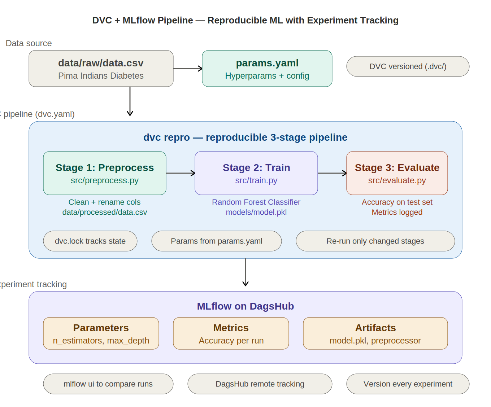

# 🔬 Reproducible ML Pipeline — DVC + MLflow + DagsHub

[](https://python.org)
[](https://dvc.org)
[](https://mlflow.org)
[](https://scikit-learn.org)
[](https://dagshub.com)

A **clean, minimal MLOps template** demonstrating how to build a fully reproducible ML pipeline using DVC for data/model versioning and pipeline orchestration, with MLflow experiment tracking via DagsHub. Trains a Random Forest Classifier on the Pima Indians Diabetes Dataset across 3 DVC-managed stages.

> This project is intentionally focused — it's not about the model complexity, it's about demonstrating **production MLOps practices**: reproducible pipelines, parameterised experiments, versioned data, and tracked metrics.

---

## 📑 Table of Contents

- [Why This Project](#-why-this-project)
- [Architecture](#-architecture)
- [DVC Pipeline Stages](#-dvc-pipeline-stages)
- [Tech Stack](#-tech-stack)
- [Project Structure](#-project-structure)
- [Getting Started](#-getting-started)
- [Experiment Tracking](#-experiment-tracking)
- [Key DVC Commands](#-key-dvc-commands)
- [Results & Metrics](#-results--metrics)
- [Future Improvements](#-future-improvements)

---

## 🎯 Why This Project

Most ML projects are Jupyter notebooks that can't be reproduced. This project shows the right way to structure ML work from day one:

- **Change a hyperparameter in `params.yaml`** → `dvc repro` automatically re-runs only the affected stages
- **Every experiment is logged** to MLflow with params, metrics, and model artifacts
- **Data and models are versioned** with DVC — you can go back to any previous state
- **The pipeline is defined as code** in `dvc.yaml` — anyone can clone and reproduce your exact results

It's the MLOps foundation that scales to any project.

---

## 🏗 Architecture



**Pipeline Flow:** Raw data (`data/raw/data.csv`) + hyperparameters (`params.yaml`) → DVC pipeline (`dvc repro`) runs 3 stages in sequence: Preprocess → Train → Evaluate → All params, metrics, and artifacts logged to MLflow on DagsHub. DVC tracks data versions, pipeline state (`dvc.lock`), and ensures only changed stages re-run.

---

## 🔄 DVC Pipeline Stages

The pipeline is defined in `dvc.yaml` and executed with a single command:

```bash
dvc repro
```

DVC automatically determines which stages need to re-run based on what changed (data, code, or parameters).

### Stage 1: Preprocess (`src/preprocess.py`)

| | |
|---|---|
| **Input** | `data/raw/data.csv` (Pima Indians Diabetes Dataset) |
| **Output** | `data/processed/data.csv` |
| **What it does** | Reads raw data, cleans column names, handles formatting, outputs processed dataset |
| **Params** | `preprocess.input`, `preprocess.output` |

### Stage 2: Train (`src/train.py`)

| | |
|---|---|
| **Input** | `data/processed/data.csv` |
| **Output** | `models/model.pkl` (serialised Random Forest) |
| **What it does** | Loads processed data, trains a Random Forest Classifier with params from `params.yaml`, saves the model, logs hyperparameters to MLflow |
| **Params** | `train.n_estimators`, `train.max_depth`, `train.random_state` |

### Stage 3: Evaluate (`src/evaluate.py`)

| | |
|---|---|
| **Input** | `models/model.pkl` + `data/processed/data.csv` |
| **Output** | Metrics logged to MLflow |
| **What it does** | Loads trained model, evaluates accuracy on the dataset, logs evaluation metrics to MLflow |

### Pipeline DAG

```bash
dvc dag
```

```
+------------+      +--------+      +----------+
| preprocess | ───→ | train  | ───→ | evaluate |
+------------+      +--------+      +----------+
```

---

## 🛠 Tech Stack

| Tool | Role |
|---|---|
| **Python 3.8+** | Core language |
| **DVC** | Data versioning, pipeline orchestration (`dvc.yaml`), reproducibility (`dvc.lock`) |
| **MLflow** | Experiment tracking — logs hyperparameters, accuracy, model artifacts per run |
| **DagsHub** | Remote MLflow tracking server + DVC storage backend |
| **scikit-learn** | Random Forest Classifier, train/test split, accuracy scoring |
| **pandas** | Data loading and preprocessing |
| **pickle** | Model serialisation |

### Why DVC + MLflow Together?

| Tool | What it tracks | Best for |
|---|---|---|
| **DVC** | Data versions, pipeline stages, code dependencies | "Can I reproduce this exact result?" |
| **MLflow** | Hyperparameters, metrics, model artifacts per experiment | "Which experiment performed best?" |

They're complementary — DVC ensures reproducibility at the pipeline level, MLflow enables comparison at the experiment level. DagsHub ties them together with a unified remote.

---

## 📁 Project Structure

```
DVC-MLflow-Dagshub-ML-Project/
├── .dvc/                        # DVC configuration + cache
├── data/
│   ├── raw/
│   │   └── data.csv             # Original Pima Indians Diabetes dataset
│   └── processed/
│       └── data.csv             # Cleaned dataset (output of preprocess stage)
├── models/
│   └── model.pkl                # Trained Random Forest model
├── src/
│   ├── preprocess.py            # Stage 1: Data cleaning + preparation
│   ├── train.py                 # Stage 2: Model training + MLflow logging
│   └── evaluate.py              # Stage 3: Evaluation + MLflow metric logging
├── assets/                      # Architecture diagram
│   └── architecture.png
├── dvc.yaml                     # Pipeline definition (stages, deps, outputs)
├── dvc.lock                     # Pipeline state lock (ensures reproducibility)
├── params.yaml                  # Hyperparameters (n_estimators, max_depth, etc.)
├── requirements.txt             # Python dependencies
├── .dvcignore                   # Files DVC should ignore
├── .gitignore
└── README.md
```

---

## 🚀 Getting Started

### Prerequisites

- Python 3.8+
- DVC installed (`pip install dvc`)
- DagsHub account (for remote MLflow tracking, optional)

### Setup

```bash
# 1. Clone the repo
git clone https://github.com/nishantrv/DVC-MLflow-Dagshub-ML-Project.git
cd DVC-MLflow-Dagshub-ML-Project

# 2. Create virtual environment
python -m venv venv
source venv/bin/activate  # Windows: venv\Scripts\activate

# 3. Install dependencies
pip install -r requirements.txt

# 4. Pull DVC-tracked data (if using remote storage)
dvc pull

# 5. Run the full pipeline
dvc repro
```

### Change Hyperparameters and Re-run

```yaml
# Edit params.yaml
train:
  n_estimators: 200      # was 100
  max_depth: 10          # was 5
  random_state: 42
```

```bash
# DVC only re-runs stages affected by the parameter change
dvc repro
```

### Set Up MLflow Tracking (DagsHub)

```bash
export MLFLOW_TRACKING_URI="https://dagshub.com/<username>/<repo>.mlflow"
export MLFLOW_TRACKING_USERNAME="<dagshub-username>"
export MLFLOW_TRACKING_PASSWORD="<dagshub-token>"

# Now dvc repro will log experiments to DagsHub
dvc repro
```

---

## 📊 Experiment Tracking

Every training run logs to MLflow:

- **Parameters** — `n_estimators`, `max_depth`, `random_state` from `params.yaml`
- **Metrics** — accuracy score on the dataset
- **Artifacts** — `models/model.pkl`

### View Experiments Locally

```bash
mlflow ui --port 5001
# Open http://localhost:5001
```

### View on DagsHub

Navigate to your DagsHub repo → Experiments tab → compare runs side by side.

### Example: Comparing Runs

| Run | n_estimators | max_depth | Accuracy |
|---|---|---|---|
| Run 1 | 100 | 5 | — |
| Run 2 | 200 | 10 | — |
| Run 3 | 300 | 15 | — |

> *Fill in your actual metrics. The power is in showing how different hyperparameters affect results — tracked automatically.*

---

## 🔧 Key DVC Commands

```bash
# Run the full pipeline (only re-runs changed stages)
dvc repro

# View the pipeline DAG
dvc dag

# Check pipeline status (which stages are outdated)
dvc status

# Push data/models to remote storage
dvc push

# Pull data/models from remote storage
dvc pull

# Add a new stage to the pipeline
dvc stage add -n <stage_name> -d <dependency> -o <output> python <script>
```

### Adding Pipeline Stages (Reference)

```bash
# Preprocess stage
dvc stage add -n preprocess \
  -p preprocess.input,preprocess.output \
  -d src/preprocess.py -d data/raw/data.csv \
  -o data/processed/data.csv \
  python src/preprocess.py

# Train stage
dvc stage add -n train \
  -p train.data,train.model,train.random_state,train.n_estimators,train.max_depth \
  -d src/train.py -d data/processed/data.csv \
  -o models/model.pkl \
  python src/train.py

# Evaluate stage
dvc stage add -n evaluate \
  -d src/evaluate.py -d models/model.pkl -d data/processed/data.csv \
  python src/evaluate.py
```


## 🤝 Contributing

Contributions and feedback are welcome! Feel free to open an issue or submit a pull request.

---

## 📄 License

This project is licensed under the MIT License.

---

**Built by [Nishant Ranjan Verma](https://github.com/nishantrv)** | Dublin, Ireland